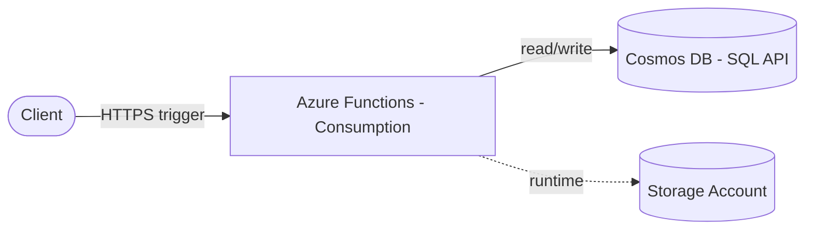

# Azure Functions + Cosmos DB (Terraform)

> Serverless compute (Azure Functions, consumption) with a globally distributed Cosmos DB backend — provisioned with Terraform.
> **Author:** Muhammad Ahmad · **IaC:** Terraform · **Cloud:** Azure


---

## 📌 Overview

- **Azure Functions** on a **consumption plan** — scale to zero, pay per execution.
- **Cosmos DB (SQL API)** — a low-latency, globally distributed NoSQL store with a `appdb` database and `items` container partitioned on `/id`.
- A **storage account** backs the Functions runtime.
- The function app is wired to Cosmos via app settings.

## 🏗️ Architecture



## 🚀 Deploy

```bash
cd terraform
az login
terraform init
terraform apply
```

Then publish your function code to the created app (e.g. `func azure functionapp publish <name>`).

## 🧹 Clean up

```bash
terraform destroy
```

## 💰 Cost note

Consumption Functions and serverless Cosmos scale to near-zero cost when idle (Cosmos has a minimum provisioned throughput charge on this SKU).

## 🔐 Production hardening (next steps)

- Use **managed identity** + Cosmos RBAC instead of keys.
- Add **Application Insights** for tracing.
- Restrict Cosmos with a **Private Endpoint**.

---

*Built and maintained by **Muhammad Ahmad**.*
