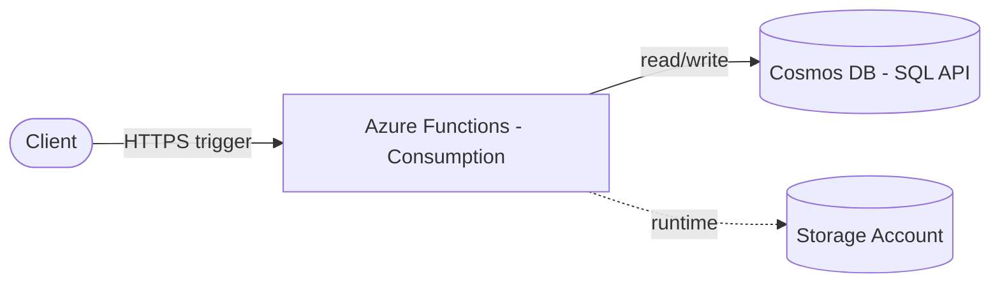

# Architecture Diagram — Azure Functions + Cosmos DB

## Lucid diagram

- **Master Lucid document (all 30 diagrams, icon style):** https://lucid.app/lucidchart/3da75ce3-ea66-4296-81b3-00d20a60435b/edit
- This project is **page 14** of that document.

## Lucid prompt (reusable)

```
Create an Azure architecture diagram titled "Azure Functions + Cosmos DB".
A Client sends an HTTPS trigger to an Azure Functions app (consumption plan); the
function reads and writes a Cosmos DB (SQL API) account, and uses a Storage Account
for its runtime. Label the arrows. Clean, professional Azure colors.
```

## Mermaid source


